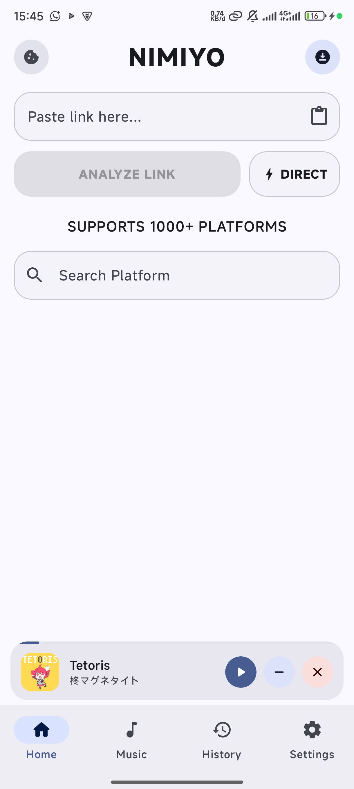
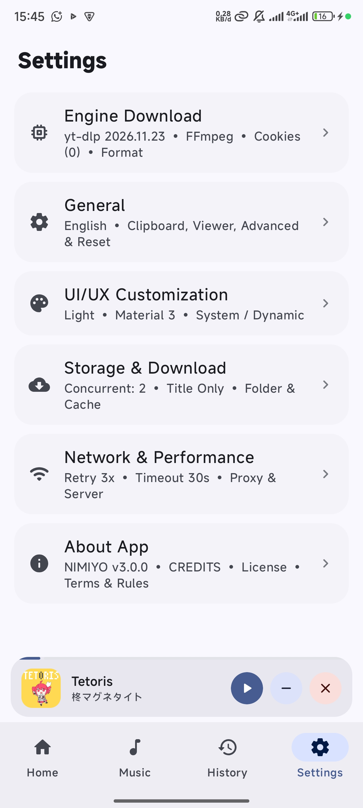
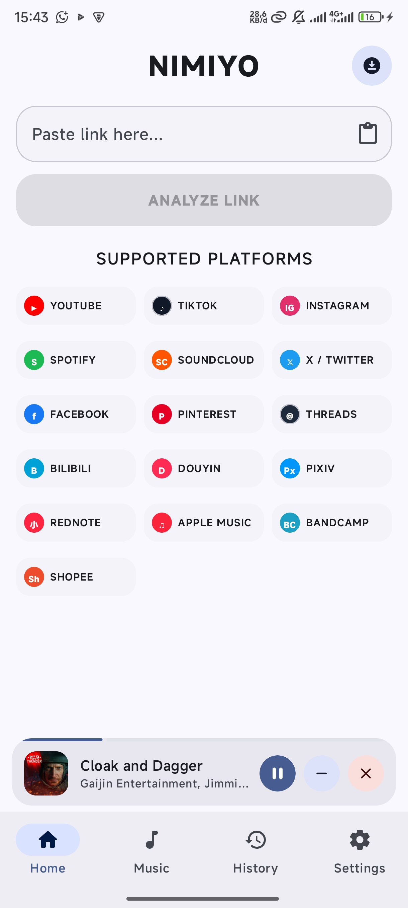
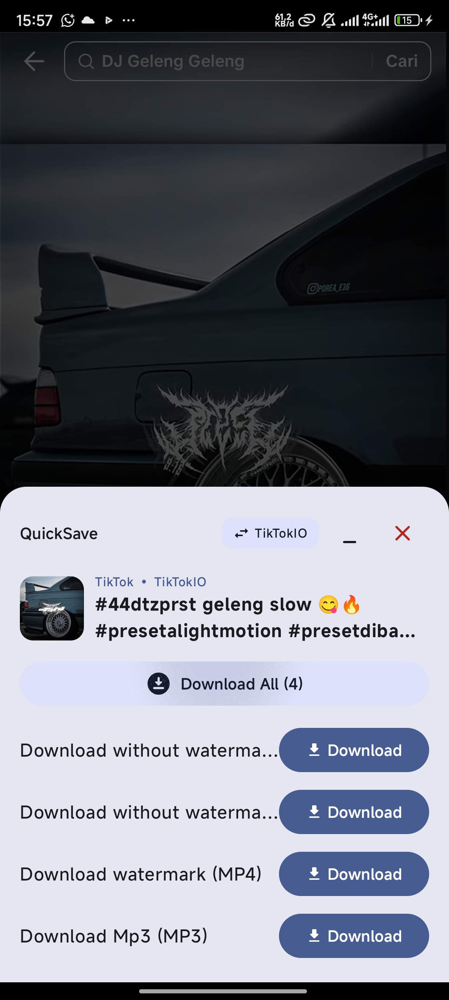
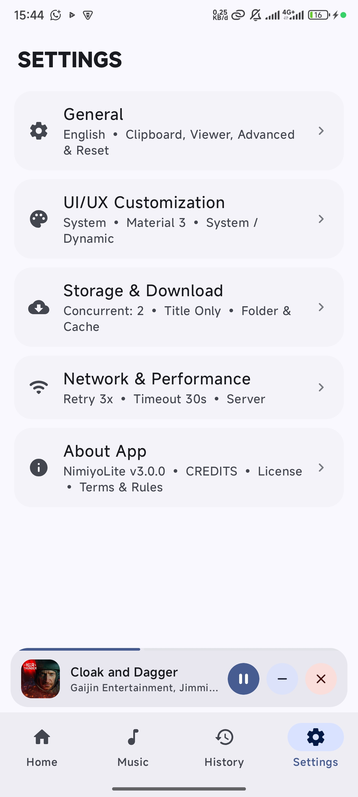
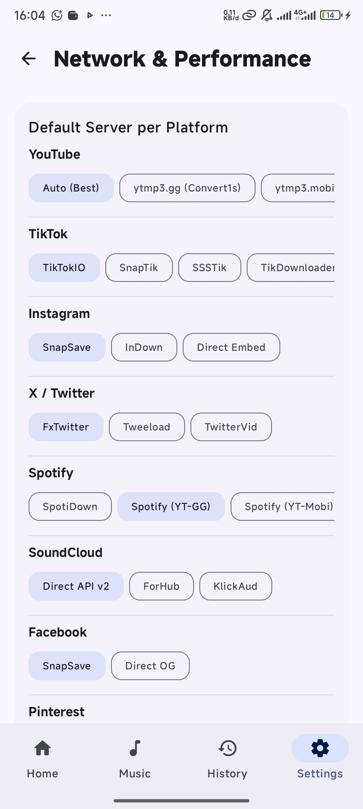
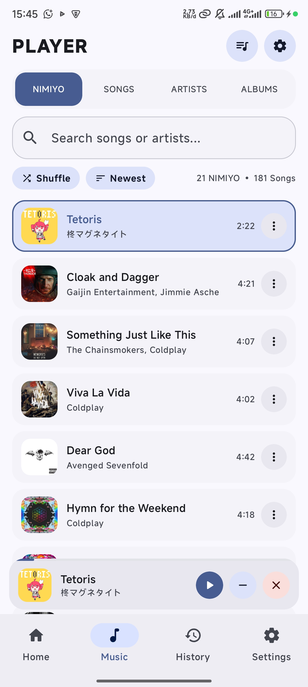
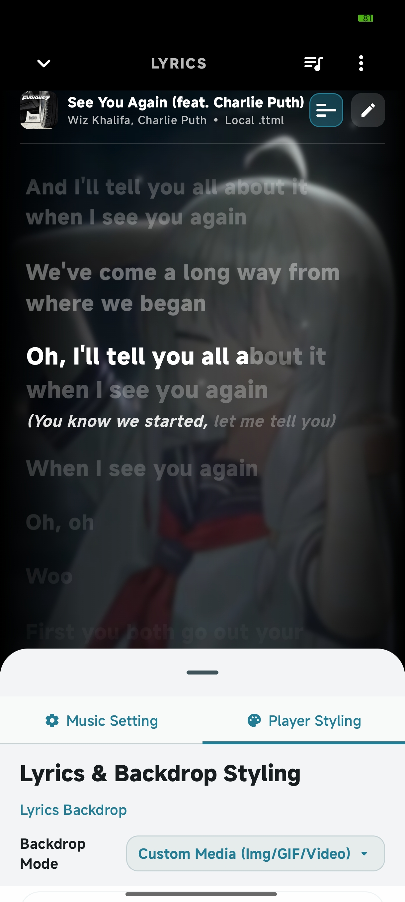
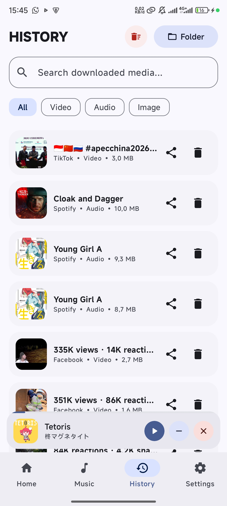

<div align="center">

  

  <h1>🐥 NIMIYO Downloader</h1>

  <p align="center">
    <a href="README.md">
      
    </a>
    <a href="README_ID.md">
      
    </a>
  </p>

  <p align="center">
    <strong>Universal Native Android Media Downloader, Music Player &amp; Dual-Engine Lyrics Suite.</strong>
    <br />
    <em>Rebuilt from the ground up in 100% Native Kotlin &amp; Jetpack Compose.</em>
  </p>

  <p align="center">
    <a href="#-two-editions-nimiyo-vs-nimiyolite"><b>Editions</b></a> •
    <a href="#-features"><b>Features</b></a> •
    <a href="#-screenshots"><b>Screenshots</b></a> •
    <a href="#-supported-platforms"><b>Platforms</b></a> •
    <a href="#-lyrics--music-player"><b>Lyrics &amp; DSP</b></a> •
    <a href="#-building-from-source"><b>Build</b></a> •
    <a href="#-open-source--acknowledgements"><b>Credits</b></a> •
    <a href="#-legal-disclaimer--app-rules"><b>Legal</b></a>
  </p>

  <div align="center">
    
    
    
    
    
    
    <a href="https://trakteer.id/nimidz"></a>
  </div>

  <p align="center">
    
  </p>

  <br />

  <p align="center">
    <a href="https://github.com/nimidz/Nimiyo-Downloader/releases/latest">
      
    </a>
    <a href="https://github.com/nimidz/Nimiyo-Downloader/releases/latest">
      
    </a>
  </p>

</div>

---

> [!CAUTION]
> **OFFICIAL RELEASE NOTICE — NOT ON GOOGLE PLAY**
>
> **NIMIYO Downloader is NOT published on Google Play Store.** Official APKs are only distributed through [**GitHub Releases**](https://github.com/nimidz/Nimiyo-Downloader/releases/latest). Any listing on Google Play or third-party app stores using the NIMIYO name or icon is unofficial and unverified.

> [!IMPORTANT]
> **Rebuilt in 100% Native Kotlin & Jetpack Compose (v3.0.0)**
>
> Replacing the legacy v2.4.0 Capacitor WebView, NIMIYO now ships in two native editions that can be installed side-by-side: **NIMIYO (`com.nimiyo.dl`)** with built-in `yt-dlp` + `FFmpeg` + `aria2c`, and **NimiyoLite (`com.nimiyo.dllite`)** powered by lightweight Kotlin scrapers (`scrapr` by [@coflyn](https://github.com/coflyn)).

> [!NOTE]
> **100% Local Privacy & Security**
>
> Downloads, music library, playlists, history, and WebView login cookies (`cookies.txt`) stay strictly inside your device sandbox (`android:allowBackup="false"`), with zero ads or telemetry.

---

## ⚖️ Two Editions: NIMIYO vs NimiyoLite

<div id="-two-editions-nimiyo-vs-nimiyolite">

| Feature / Aspect | 🚀 **NIMIYO** (`com.nimiyo.dl`) | ⚡ **NimiyoLite** (`com.nimiyo.dllite`) |
| :--- | :--- | :--- |
| **Core Engine** | Built-in **`yt-dlp`** + **`FFmpeg`** + **`aria2c`** | Pure Kotlin **Scraper Engine** (`scrapr` by `@coflyn`) |
| **APK Size** | ~63 MB (`arm64-v8a`) | **~3.5 MB** (Ultra-lightweight) |
| **Supported Platforms** | **1000+ websites** (`yt-dlp`) + local photo scrapers | **16 curated platforms** with multi-server fallback |
| **Photo & Carousel Posts** | **Local-first** direct scraping (TikTok `/photo/`, IG, Pixiv, Threads, RedNote, Pinterest) + `FxTwitter` fallback | Multi-server scraper (TikWM, SnapTik, IG Embed, FxTwitter, Pixiv, etc.) |
| **QuickSave & Direct Mode** | Full **Direct / Analyze** toggle, custom QuickSave format preset, auto-close, Direct after share | Fast **Analyze** overlay with live **Server Switcher** (`TikTokIO`, `SnapTik`, etc.) |
| **Advanced `yt-dlp` Tools** | Subtitles (`--write-subs`), SponsorBlock, Split Chapters, MKV/MP4, Custom CLI Args, Channel Updater (`Stable`/`Nightly`) | Automatic server fallback & lazy stream resolution + local MP4 muxer (`Mp4Muxer`) |
| **Private / Login Content** | Built-in **WebView Cookie Vault** (`cookies.txt`) for IG Stories, RedNote, etc. | Cookie-free public scraping |
| **Music Player & Lyrics** | ✅ Full DSP, MixTools FX, TTML/LRC Dual-Engine Lyrics | ✅ Identical Full DSP, MixTools FX, TTML/LRC Dual-Engine Lyrics |
| **Video Player & Image Viewer** | ✅ Hardware-accelerated + 2s auto-fade controls | ✅ Hardware-accelerated + 2s auto-fade controls |
| **Recommended For** | Power users, 4K/60fps, subtitles, Spotify/Apple Music tagging, private links | Low-storage devices, instant lightweight social downloads |

</div>

---

## 📸 Screenshots

<div align="center" id="-screenshots">

### 🚀 NIMIYO (`yt-dlp` Native Edition)







---

### ⚡ NimiyoLite (Scraper Edition)






---

### 🎵 Music Player, Dual-Engine Lyrics & History (Both Editions)







</div>

---

## ✨ Features

<div align="center" id="-features">

<table>
  <tr>
    <td width="50%" valign="top">
      <div align="left">
        <h3>📥 Downloading &amp; Extraction</h3>
        <ul>
          <li><b>Dual-Mode Downloader:</b> Switch instantly between <b>Analyze Link</b> (pick exact stream) and <b>Direct</b> (one-tap preset format).</li>
          <li><b>Nimiyo QuickSave:</b> Share any link from TikTok, YouTube, Instagram, or X to download via a floating bottom sheet — switch between <b>Analyze</b> and <b>Direct</b> on the fly without changing settings.</li>
          <li><b>Local-First Photo Carousels:</b> Extracts full-resolution multi-photo galleries directly from TikTok (<code>/photo/</code>), Instagram, Pixiv, Threads, RedNote, and Pinterest.</li>
          <li><b><code>aria2c</code> Acceleration (Native):</b> Multi-connection HTTP acceleration paired with safe HLS/DASH fragment handling.</li>
          <li><b>Spotify &amp; Apple Music Resolution:</b> Extracts real artist/title/cover metadata and embeds ID3 tags &amp; artwork automatically.</li>
          <li><b>Batch &amp; Playlist Support:</b> Download entire albums, playlists, or multi-photo posts in one queue.</li>
        </ul>
      </div>
    </td>
    <td width="50%" valign="top">
      <div align="left">
        <h3>🎵 Music Player &amp; DSP Suite</h3>
        <ul>
          <li><b>Built-in Offline Library:</b> Dedicated tabs for <b>NIMIYO</b> downloads, <b>Songs</b>, <b>Artists</b>, <b>Albums</b>, and <b>Custom Playlists</b> — with a setting to swap any pill tab with <b>Playlist</b>.</li>
          <li><b>Player Styling (Lyrics Backdrop &amp; Font):</b> Customize the lyrics screen with <b>Custom Media</b> (Image, GIF, WebP, or muted looping Video with Zoom, 0–25% Blur, Opacity &amp; left/right edge fade), <b>Solid Black</b>, or <b>Album Blur</b>, plus custom <code>.ttf</code>/<code>.otf</code> fonts, weight, and text shadow.</li>
          <li><b>MixTools FX:</b> Real-time <b>Speed FX</b> (60%–140% Slowed / SpeedUp) and a <b>2D Acoustic Reverb XY Pad</b> (Wide/Tight × Dry/Wet).</li>
          <li><b>Audio Enhancement:</b> Volume Normalization &amp; Gain Boost (up to +9 dB) and Mono Audio toggle.</li>
          <li><b>Smart Playback Guards:</b> Pause on headset disconnect, auto-play on Bluetooth/headset, resume after phone call, and <b>configurable Low Battery Auto-Stop</b> (5%–50% via gear button).</li>
          <li><b>Gradual Sleep Timer:</b> Smooth 2.5-second audio fade-out before pausing.</li>
          <li><b>Floating MiniPlayer:</b> Persistent playback bar across Home, Music, History, and Settings.</li>
        </ul>
      </div>
    </td>
  </tr>
  <tr>
    <td width="50%" valign="top">
      <div align="left" id="-lyrics--music-player">
        <h3>🎤 Dual-Engine Lyrics (TTML &amp; LRC)</h3>
        <ul>
          <li><b>Independent TTML &amp; LRC Pipelines:</b> TTML (Apple Music style) and classic LRC never overwrite each other — if TTML is unavailable for a song, LRC displays automatically.</li>
          <li><b>TTML Reading Modes:</b> Choose between <b>Per Character</b> (smooth wave sweep) or <b>Per Word</b> highlighting via dropdown.</li>
          <li><b>Duet &amp; Backing Vocals:</b> Supports <code>ttm:agent</code> duet alignment (<b>Align Left</b>, <b>Align Right</b>, <b>Split Duet</b>), accordion backing vocals, instrumental interlude dots, and <code>x-translation</code> / <code>x-roman</code> sub-lines.</li>
          <li><b>Multi-Provider Search:</b> KuGou Studio, LRCLIB (with smart Japanese/Vocaloid title cleaning &amp; search fallback), Boidu TTML, BetterLyrics TTML, and Paxsenix Apple TTML.</li>
          <li><b>Full Customization:</b> Adjustable text size (Small to Extra Large), Translation toggle, Tap-to-Seek toggle, plus built-in <code>.lrc</code> / <code>.ttml</code> Editor, Importer &amp; Exporter.</li>
        </ul>
      </div>
    </td>
    <td width="50%" valign="top">
      <div align="left">
        <h3>🎨 UI/UX, Storage &amp; Built-in Viewers</h3>
        <ul>
          <li><b>UI/UX Customization:</b> Choose between <b>Material 3</b>, <b>Soft UI</b>, and <b>Neobrutalism</b> styles, Dark/Light/System theme, and Dynamic/Custom accent colors.</li>
          <li><b>12 Built-in Languages:</b> English, Indonesian, Chinese, Japanese, Arabic, Vietnamese, Thai, Korean, Spanish, Portuguese, Malay, and Hindi.</li>
          <li><b>Per-Media Custom Folders:</b> Set separate SAF destination folders for <b>Video</b>, <b>Audio</b>, <b>Images</b>, and <b>SD Card</b>, plus platform subfolders and filename templates.</li>
          <li><b>Built-in Video Player &amp; Image Viewer:</b> Hardware-accelerated ExoPlayer video viewer with 2-second auto-fadeout overlay controls and pinch-to-zoom image viewer.</li>
          <li><b>Safety &amp; Policy Guard:</b> Built-in URL &amp; metadata compliance filtering and local-only Cookie Vault.</li>
        </ul>
      </div>
    </td>
  </tr>
</table>

</div>

---

## 🌐 Supported Platforms

<div id="-supported-platforms">

- **16 Core Social, Video, Music & Art Platforms**: **YouTube & Shorts** (up to 4K + subtitles), **TikTok** (no-watermark video, MP3, & full multi-photo `/photo/` slides), **Instagram** (Reels, Stories, & full photo/video carousels), **Spotify & Apple Music** (track/album/playlist metadata resolved with automatic ID3 & cover-art tagging), **SoundCloud**, **X / Twitter** (HD video & multi-photo tweets), **Facebook** (Reels/Watch HD & SD), **Pinterest** (video pins & `/originals/` images), **Threads** (carousel photos & videos), **Pixiv** (all original artwork pages), **RedNote / Xiaohongshu**, **Douyin**, **Bilibili**, **Bandcamp**, and **Shopee Video**.
- **1,000+ Additional Sites (NIMIYO Native)**: Any other supported link (Twitch, Vimeo, Reddit, Dailymotion, Niconico, VK, Kick, Rumble, etc.) is handled directly by the built-in `yt-dlp` engine.

</div>

---

## 🚀 Building from Source

<div id="-building-from-source">

### Prerequisites
- **JDK**: Java 17 or Java 21
- **Android SDK**: Compile SDK 35 / Min SDK 26 (Android 8.0+)
- **Gradle**: Uses the included `./gradlew` wrapper

### 1. Clone the Repository
```bash
git clone https://github.com/nimidz/Nimiyo-Downloader.git
cd Nimiyo-Downloader
```

### 2. Build NIMIYO (`yt-dlp` Native Edition)
```bash
cd Nimiyo_native

# Run unit tests & build arm64-v8a release APK (fast single-ABI build)
./gradlew testDebugUnitTest assembleRelease -Parm64Only=true
```
*Output APK:* `Nimiyo_native/app/build/outputs/apk/release/app-arm64-v8a-release.apk`

### 3. Build NimiyoLite (Scraper Edition)
```bash
cd Nimiyo_scraper_versilite

./gradlew assembleRelease
```
*Output APK:* `Nimiyo_scraper_versilite/app/build/outputs/apk/release/app-release.apk`

</div>

---

## 📁 Repository Structure

| Directory / File | Description |
| :--- | :--- |
| **[Nimiyo_native/](Nimiyo_native/)** | **NIMIYO YTDLP** (`com.nimiyo.dl`) — Full `yt-dlp` + `FFmpeg` + `aria2c` native Android project |
| ↳ [app/src/main/java/com/nimiyo/nativeapp/](Nimiyo_native/app/src/main/java/com/nimiyo/nativeapp/) | Kotlin source root ([`download/`](Nimiyo_native/app/src/main/java/com/nimiyo/nativeapp/download/), [`player/`](Nimiyo_native/app/src/main/java/com/nimiyo/nativeapp/player/), [`scraper/`](Nimiyo_native/app/src/main/java/com/nimiyo/nativeapp/scraper/), [`ui/screens/`](Nimiyo_native/app/src/main/java/com/nimiyo/nativeapp/ui/screens/)) |
| **[Nimiyo_scraper_versilite/](Nimiyo_scraper_versilite/)** | **NimiyoLite** (`com.nimiyo.dllite`) — Lightweight multi-server scraper Android project |
| ↳ [app/src/main/java/com/nimiyo/nativeapp/](Nimiyo_scraper_versilite/app/src/main/java/com/nimiyo/nativeapp/) | Kotlin source root ([`download/`](Nimiyo_scraper_versilite/app/src/main/java/com/nimiyo/nativeapp/download/), [`player/`](Nimiyo_scraper_versilite/app/src/main/java/com/nimiyo/nativeapp/player/), [`scraper/`](Nimiyo_scraper_versilite/app/src/main/java/com/nimiyo/nativeapp/scraper/), [`ui/screens/`](Nimiyo_scraper_versilite/app/src/main/java/com/nimiyo/nativeapp/ui/screens/)) |
| **[assets/screenshots/](assets/screenshots/)** | App screenshots ([`nimiyo-ytdlp/`](assets/screenshots/nimiyo-ytdlp/), [`nimiyo-lite/`](assets/screenshots/nimiyo-lite/), [`shared/`](assets/screenshots/shared/)) |
| **[assets/icon/](assets/icon/)** | Transparent app logo (`iconaboutapp.png`) |
| **[version.json](version.json)** | Remote update metadata for in-app update checker |
| **[RELEASE_NOTES_v3.0.0.md](RELEASE_NOTES_v3.0.0.md)** | Release changelog & APK download table |

---

## 🌐 Connect with Developer

- 📸 **Instagram**: [@nimidzy](https://instagram.com/nimidzy)
- 🎵 **TikTok**: [@nimidz](https://tiktok.com/@nimidz)
- 🎬 **YouTube**: [@nimidz](https://youtube.com/@nimidz)
- 🐙 **GitHub**: [@nimidz](https://github.com/nimidz)
- ☕ **Support / Donasi**: [Trakteer.id/nimidz](https://trakteer.id/nimidz)

---

## ⚙️ Development & Engineering

- **Architecture**: 100% Native **Kotlin** + **Jetpack Compose** (`Material 3`, `Soft UI`, `Neobrutalism`), `StateFlow` reactive state management, and Foreground Services for uninterrupted background downloads and media playback.
- **Audio DSP Pipeline**: Custom `NimiyoDspAudioProcessor` built on **AndroidX Media3 / ExoPlayer** supporting real-time speed/pitch adjustment and 2D spatial reverb.
- **Storage Compliance**: Android Scoped Storage (`MediaStore`) + Storage Access Framework (`SAF`) for per-media custom folders & SD Card output.

---

## 📜 Legal Disclaimer & App Rules

<div id="-legal-disclaimer--app-rules">

> [!WARNING]
> **User Responsibility & Copyright**
>
> NIMIYO Downloader is intended strictly for **personal, offline archiving, and educational use**. Users are solely responsible for ensuring they have the right or permission to download any content and for complying with the Terms of Service of source platforms and applicable copyright laws in their jurisdiction.

### Built-in App Rules (`NimiyoContentGuard`)
To keep the application safe and responsible, NIMIYO enforces built-in URL and metadata filtering that blocks:
- **Adult / NSFW (18+) content**
- **Extreme violence & gore**
- **Hate speech & harassment**
- **Illegal or harmful content**

</div>

---

## 🤝 Open Source & Acknowledgements

<div id="-open-source--acknowledgements">

- **Creator & Maintainer**: Built with ❤️ by [**nimidz**](https://github.com/nimidz)
- **Scraper Architecture**: Powered by `scrapr` engine concepts by [**@coflyn**](https://github.com/coflyn)
- **Download & Media Engines**:
  - [**yt-dlp**](https://github.com/yt-dlp/yt-dlp) & [**youtubedl-android**](https://github.com/yausername/youtubedl-android) (`yausername`)
  - [**FFmpeg**](https://ffmpeg.org/) & [**aria2c**](https://aria2.github.io/)
- **Lyrics Providers**:
  - **KuGou Studio**, **LRCLIB**, **Boidu TTML**, **BetterLyrics TTML**, & **Paxsenix Apple TTML**
- **Android Stack**:
  - **Kotlin**, **Jetpack Compose (Material 3)**, **AndroidX Media3 / ExoPlayer**, **Coil**, **OkHttp**, & **Jsoup**

</div>

---

## ⚖️ License, Copyright & Trademark

- **License**: Distributed under the **GNU General Public License v3.0 (GPL-3.0)**. See [`LICENSE`](LICENSE) for full terms.
- **Copyright**: © 2026 **NIMIYO** (`nimidz`).
- **Trademark Notice**: All third-party platform names, logos, and trademarks (YouTube, TikTok, Instagram, Spotify, Apple Music, X/Twitter, Facebook, Pixiv, Threads, SoundCloud, etc.) belong to their respective owners. NIMIYO is an independent open-source project and is not affiliated with, endorsed by, or sponsored by any of these platforms.

---

<div align="center">
  <sub>Licensed under GPL-3.0 • Made with passion for media freedom. © 2026 NIMIYO.</sub>
</div>

