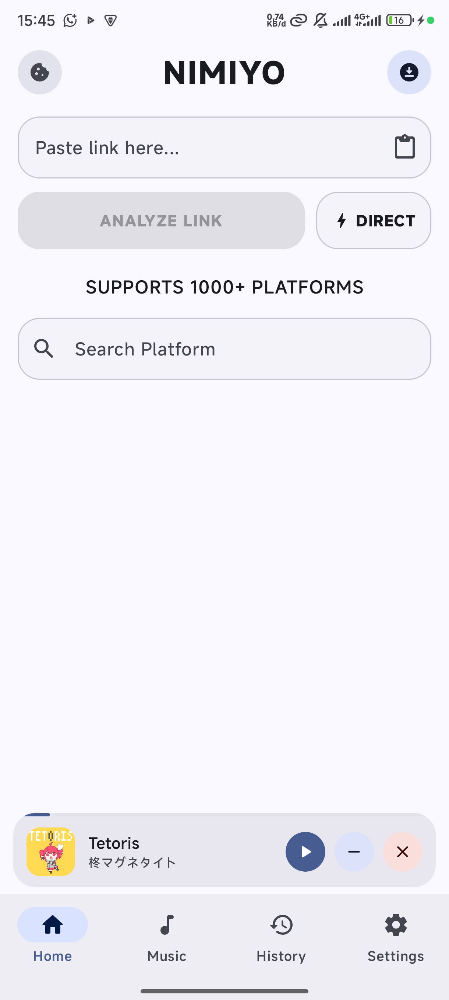
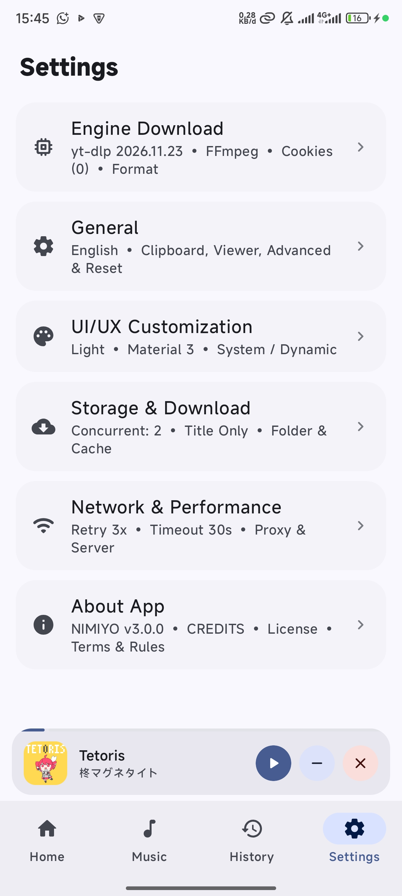
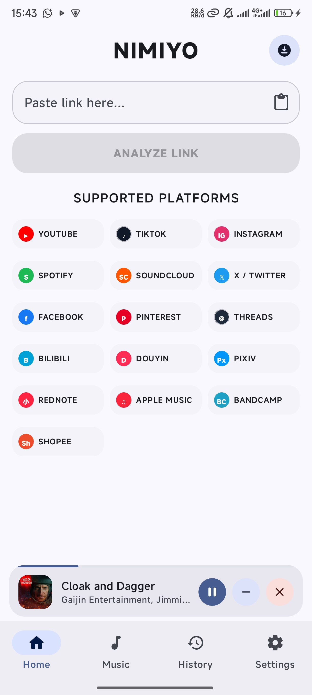
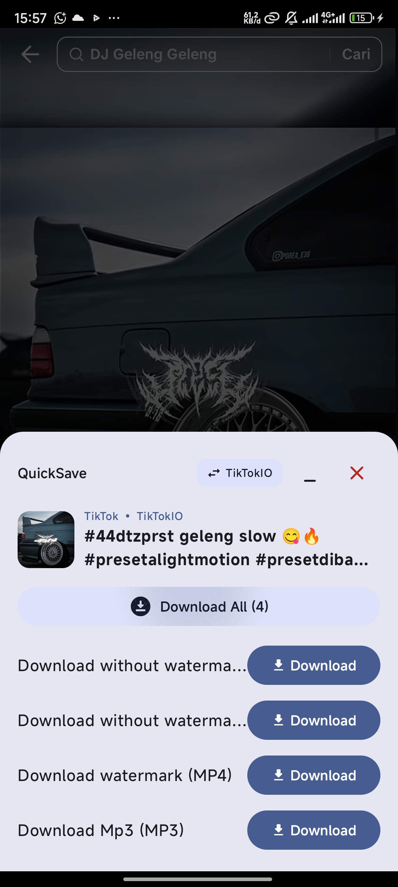
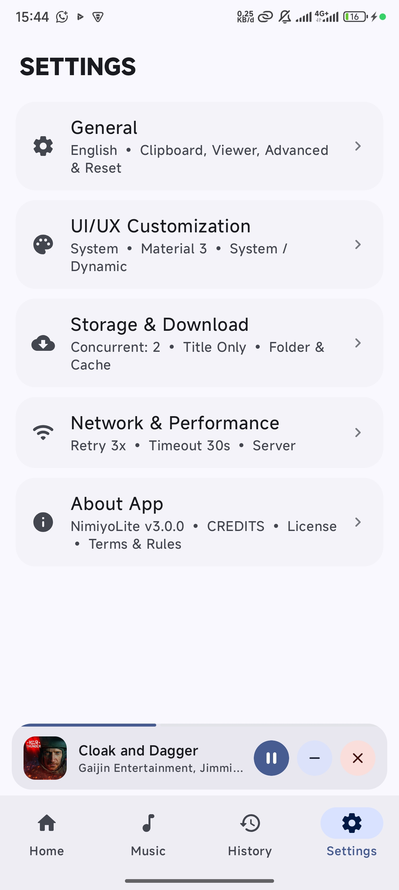
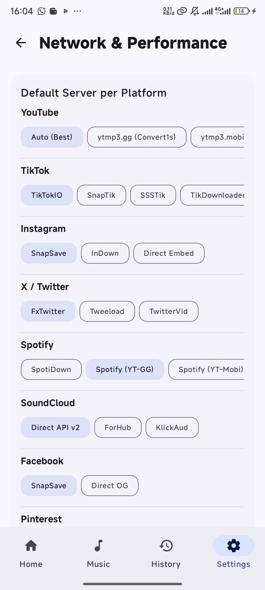
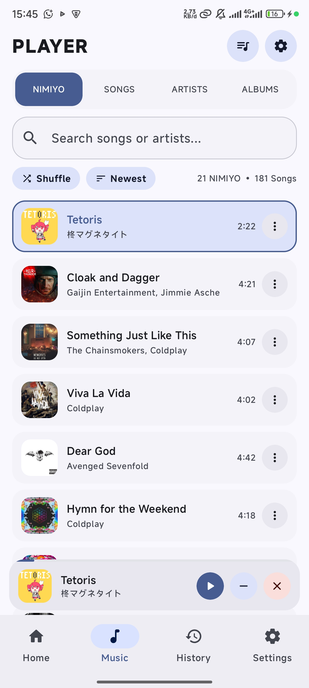
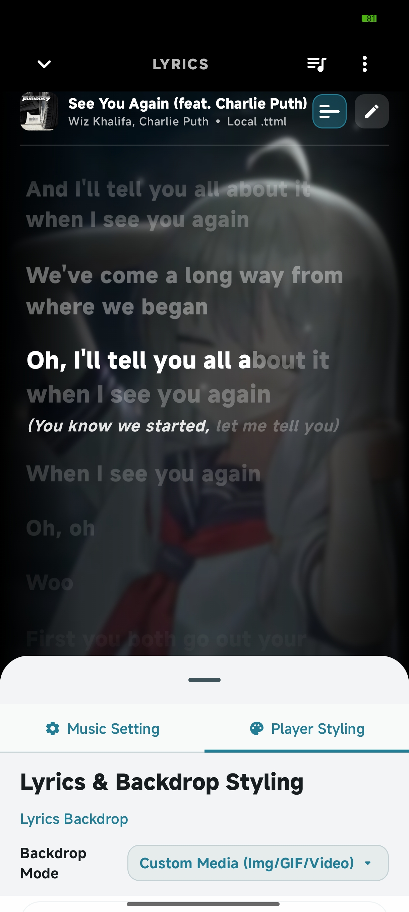
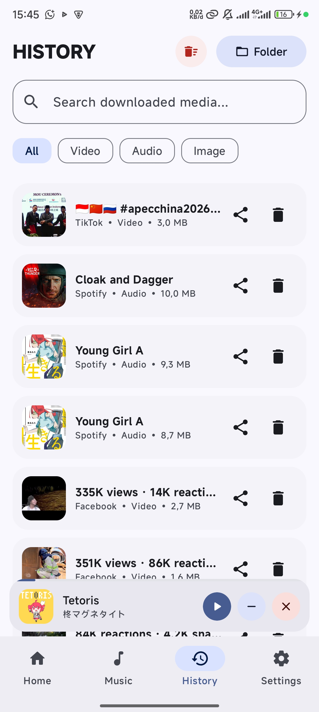

<div align="center">

  

  <h1>🐥 NIMIYO Downloader</h1>

  <p align="center">
    <a href="README.md">
      
    </a>
    <a href="README_ID.md">
      
    </a>
  </p>

  <p align="center">
    <strong>Pengunduh Media Android Native Universal, Pemutar Musik &amp; Lirik Dual-Engine.</strong>
    <br />
    <em>Dibangun ulang sepenuhnya dengan 100% Native Kotlin &amp; Jetpack Compose — tanpa iklan, tanpa pelacak, tersedia dalam dua edisi.</em>
  </p>

  <p align="center">
    <a href="#-dua-edisi-nimiyo-vs-nimiyolite"><b>Edisi</b></a> •
    <a href="#-fitur-unggulan"><b>Fitur</b></a> •
    <a href="#-tangkapan-layar"><b>Screenshot</b></a> •
    <a href="#-platform-yang-didukung"><b>Platform</b></a> •
    <a href="#-lirik--pemutar-musik"><b>Lirik &amp; DSP</b></a> •
    <a href="#-cara-build-dari-source"><b>Build</b></a> •
    <a href="#-open-source--penghargaan"><b>Credits</b></a> •
    <a href="#-disclaimer-hukum--peraturan-aplikasi"><b>Legal</b></a>
  </p>

  <div align="center">
    
    
    
    
    
    
    <a href="https://trakteer.id/nimidz"></a>
  </div>

  <p align="center">
    
  </p>

  <br />

  <p align="center">
    <a href="https://github.com/nimidz/Nimiyo-Downloader/releases/latest">
      
    </a>
    <a href="https://github.com/nimidz/Nimiyo-Downloader/releases/latest">
      
    </a>
  </p>

</div>

---

> [!CAUTION]
> **PERINGATAN RILIS RESMI — TIDAK TERSEDIA DI GOOGLE PLAY**
>
> **NIMIYO Downloader TIDAK pernah dirilis di Google Play Store.** APK resmi hanya dibagikan melalui [**GitHub Releases**](https://github.com/nimidz/Nimiyo-Downloader/releases/latest). Aplikasi apa pun di Google Play atau toko pihak ketiga yang memakai nama/ikon NIMIYO adalah tidak resmi.

> [!IMPORTANT]
> **Dibangun Ulang dengan 100% Native Kotlin & Jetpack Compose (v3.0.0)**
>
> Menggantikan WebView Capacitor v2.4.0 lama, NIMIYO kini hadir dalam dua edisi native yang bisa dipasang berdampingan: **NIMIYO (`com.nimiyo.dl`)** dengan `yt-dlp` + `FFmpeg` + `aria2c` bawaan, dan **NimiyoLite (`com.nimiyo.dllite`)** berbasis scraper Kotlin ringan (`scrapr` oleh [@coflyn](https://github.com/coflyn)).

> [!NOTE]
> **Privasi & Keamanan 100% Lokal**
>
> Unduhan, pustaka musik, playlist, riwayat, dan cookie login WebView (`cookies.txt`) tetap berada di sandbox privat perangkat (`android:allowBackup="false"`), tanpa iklan maupun pelacak.

---

## ⚖️ Dua Edisi: NIMIYO vs NimiyoLite

<div id="-dua-edisi-nimiyo-vs-nimiyolite">

| Fitur / Aspek | 🚀 **NIMIYO** (`com.nimiyo.dl`) | ⚡ **NimiyoLite** (`com.nimiyo.dllite`) |
| :--- | :--- | :--- |
| **Mesin Utama** | **`yt-dlp`** + **`FFmpeg`** + **`aria2c`** bawaan | **Scraper Kotlin** murni (`scrapr` oleh `@coflyn`) |
| **Ukuran APK** | ~63 MB (`arm64-v8a`) | **~3.5 MB** (Super ringan) |
| **Dukungan Situs** | **1000+ situs** (`yt-dlp`) + scraper foto lokal | **16 platform utama** dengan multi-server otomatis |
| **Postingan Foto / Carousel** | **Lokal langsung** (TikTok `/photo/`, IG, Pixiv, Threads, RedNote, Pinterest) + fallback `FxTwitter` | Scraper multi-server (TikWM, SnapTik, IG Embed, FxTwitter, Pixiv, dll) |
| **QuickSave & Mode Direct** | Switch **Direct / Analisis** langsung di jendela, format khusus QuickSave, auto-close, Direct after share | Overlay **Analisis** cepat dengan **Pengganti Server** langsung (`TikTokIO`, `SnapTik`, dll) |
| **Fitur Lanjutan `yt-dlp`** | Subtitle (`--write-subs`), SponsorBlock, Split Chapters, MKV/MP4, Custom CLI Args, Update (`Stable`/`Nightly`) | Fallback server otomatis & muxer MP4 lokal (`Mp4Muxer`) |
| **Konten Privat / Login** | **WebView Cookie Vault** (`cookies.txt`) untuk IG Stories, RedNote, dll | Scraping publik tanpa cookie |
| **Pemutar Musik & Lirik** | ✅ Full DSP, MixTools FX, Lirik Dual-Engine TTML/LRC | ✅ Sama persis (Full DSP, MixTools FX, Lirik TTML/LRC) |
| **Video Player & Image Viewer** | ✅ Akselerasi hardware + kontrol auto-fade 2 detik | ✅ Akselerasi hardware + kontrol auto-fade 2 detik |
| **Cocok Untuk** | Power user, 4K/60fps, subtitle, tagging Spotify/Apple Music, link privat | HP memori hemat, download sosmed cepat & ringan |

</div>

---

## 📸 Tangkapan Layar

<div align="center" id="-tangkapan-layar">

### 🚀 NIMIYO (`yt-dlp` Native Edition)







---

### ⚡ NimiyoLite (Scraper Edition)






---

### 🎵 Pemutar Musik, Lirik Dual-Engine & Riwayat (Kedua Edisi)







</div>

---

## ✨ Fitur Unggulan

<div align="center" id="-fitur-unggulan">

<table>
  <tr>
    <td width="50%" valign="top">
      <div align="left">
        <h3>📥 Pengunduhan &amp; Ekstraksi</h3>
        <ul>
          <li><b>Downloader Dual-Mode:</b> Beralih cepat antara <b>Analisis Link</b> (pilih resolusi/format) dan <b>Direct</b> (satu ketuk langsung unduh sesuai preset).</li>
          <li><b>Nimiyo QuickSave:</b> Bagikan tautan dari TikTok, YouTube, Instagram, atau X lewat panel melayang — dilengkapi tombol switch <b>Analisis / Direct</b> langsung tanpa ubah setelan.</li>
          <li><b>Ekstraksi Foto Banyak Lokal:</b> Mengunduh semua slide foto resolusi penuh langsung dari TikTok (<code>/photo/</code>), Instagram, Pixiv, Threads, RedNote, dan Pinterest.</li>
          <li><b>Akselerasi <code>aria2c</code> (Native):</b> Koneksi paralel HTTP untuk unduhan lebih kencang tanpa merusak muxing HLS/DASH.</li>
          <li><b>Tagging Spotify &amp; Apple Music:</b> Otomatis menempelkan judul, artis, dan sampul album ke file MP3.</li>
          <li><b>Batch &amp; Playlist:</b> Unduh seluruh album, playlist, atau postingan multi-foto sekaligus.</li>
        </ul>
      </div>
    </td>
    <td width="50%" valign="top">
      <div align="left">
        <h3>🎵 Pemutar Musik &amp; DSP</h3>
        <ul>
          <li><b>Pustaka Offline Lengkap:</b> Tab khusus unduhan <b>NIMIYO</b>, <b>Lagu</b>, <b>Artis</b>, <b>Album</b>, dan <b>Playlist Kustom</b> — dilengkapi pengaturan untuk menukar salah satu pill tab menjadi tombol <b>Playlist</b>.</li>
          <li><b>Player Styling (Latar &amp; Font Lirik):</b> Kustomisasi layar lirik dengan <b>Media Custom</b> (Gambar, GIF, WebP, atau Video loop bisu dengan Zoom, Blur 0–25%, Opasitas &amp; pudar kanan-kiri), <b>Hitam Pekat</b>, atau <b>Album Blur</b>, serta pilih font <code>.ttf</code>/<code>.otf</code> custom, ketebalan, dan bayangan teks.</li>
          <li><b>MixTools FX:</b> Pengatur kecepatan real-time <b>Speed FX</b> (60%–140% Slowed / SpeedUp) dan <b>2D Reverb XY Pad</b> (Wide/Tight × Dry/Wet).</li>
          <li><b>Peningkat Audio:</b> Normalisasi Volume, Penguat Gain (hingga +9 dB), dan Audio Mono.</li>
          <li><b>Pengaman Pemutaran Cerdas:</b> Jeda saat headset dilepas, auto-play Bluetooth/headset, lanjut setelah telepon, dan <b>Hentikan Saat Baterai Lemah</b> yang persentasenya bisa diatur (5%–50% via ikon gear).</li>
          <li><b>Sleep Timer Fade-out:</b> Volume mengecil halus selama 2,5 detik sebelum musik berhenti.</li>
          <li><b>MiniPlayer Melayang:</b> Tetap muncul rapi di seluruh halaman utama.</li>
        </ul>
      </div>
    </td>
  </tr>
  <tr>
    <td width="50%" valign="top">
      <div align="left" id="-lirik--pemutar-musik">
        <h3>🎤 Lirik Dual-Engine (TTML &amp; LRC)</h3>
        <ul>
          <li><b>Jalur TTML &amp; LRC Terpisah:</b> TTML dan LRC tidak saling menimpa — jika TTML tidak tersedia untuk suatu lagu, LRC otomatis ditampilkan agar lirik tidak kosong.</li>
          <li><b>Mode Baca TTML:</b> Pilih animasi <b>Per Huruf</b> (sapuan huruf halus) atau <b>Per Kata</b> lewat dropdown.</li>
          <li><b>Duet &amp; Vokal Latar:</b> Mendukung <code>ttm:agent</code> (<b>Rata Kiri</b>, <b>Rata Kanan</b>, <b>Pisah Duet</b>), vokal belakang akordeon, titik jeda instrumental, dan baris <code>x-translation</code> / <code>x-roman</code>.</li>
          <li><b>Pencarian Multi-Provider:</b> KuGou Studio, LRCLIB (dengan pembersih judul Jepang/Vocaloid &amp; fallback pencarian), Boidu TTML, BetterLyrics TTML, dan Paxsenix Apple TTML.</li>
          <li><b>Kustomisasi Lengkap:</b> Ukuran teks (Kecil s/d Ekstra Besar), saklar Terjemahan, saklar Ketuk Lirik untuk Lompat, serta Editor, Impor &amp; Ekspor <code>.lrc</code> / <code>.ttml</code>.</li>
        </ul>
      </div>
    </td>
    <td width="50%" valign="top">
      <div align="left">
        <h3>🎨 UI/UX, Penyimpanan &amp; Pemutar Bawaan</h3>
        <ul>
          <li><b>Kustomisasi UI/UX:</b> Pilih gaya <b>Material 3</b>, <b>Glassmorphism</b>, atau <b>Cupertino (iOS)</b>, tema Gelap/Terang/Sistem, saklar khusus <b>Dynamic Color</b> (warna wallpaper Material You di Android 12+), serta <b>12 palet warna tonal full-interface</b> (<i>Matcha, Mint Teal, Aqua, Ocean, Indigo, Lavender, Sakura, Crimson, Sunset, Amber, Mocha, Slate</i>) dalam grid 4 kolom rapi yang mewarnai seluruh latar belakang, surface, kartu, dan aksen.</li>
          <li><b>12 Bahasa Bawaan:</b> Indonesia, Inggris, Mandarin, Jepang, Arab, Vietnam, Thailand, Korea, Spanyol, Portugis, Melayu, dan Hindi.</li>
          <li><b>Folder Kustom per Media:</b> Atur folder tujuan terpisah untuk <b>Video</b>, <b>Audio</b>, <b>Gambar</b>, dan <b>Kartu SD</b>, plus subfolder platform &amp; template nama file.</li>
          <li><b>Video Player &amp; Image Viewer Bawaan:</b> Pemutar video ExoPlayer dengan auto-fadeout kontrol 2 detik dan penampil gambar pinch-to-zoom.</li>
          <li><b>Pelindung Konten &amp; Privasi:</b> Filter keamanan URL/metadata bawaan dan Cookie Vault khusus lokal.</li>
        </ul>
      </div>
    </td>
  </tr>
</table>

</div>

---

## 🌐 Platform yang Didukung

<div id="-platform-yang-didukung">

- **16 Platform Utama Video, Musik, Sosmed & Ilustrasi**: **YouTube & Shorts** (hingga 4K + subtitle), **TikTok** (video tanpa watermark, MP3, & seluruh slide galeri `/photo/`), **Instagram** (Reels, Stories, & semua slide carousel foto/video), **Spotify & Apple Music** (resolusi lagu/album/playlist lengkap dengan tag ID3 & cover art otomatis), **SoundCloud**, **X / Twitter** (video HD & multi-foto), **Facebook** (Reels/Watch HD & SD), **Pinterest** (pin video & gambar `/originals/`), **Threads** (foto carousel & video), **Pixiv** (semua halaman artwork asli), **RedNote / Xiaohongshu**, **Douyin**, **Bilibili**, **Bandcamp**, dan **Shopee Video**.
- **1.000+ Situs Tambahan (NIMIYO Native)**: Situs lainnya (Twitch, Vimeo, Reddit, Dailymotion, Niconico, VK, Kick, Rumble, dll) langsung didukung melalui mesin `yt-dlp` bawaan.

</div>

---

## 🚀 Cara Build dari Source

<div id="-cara-build-dari-source">

### Prasyarat
- **JDK**: Java 17 atau Java 21
- **Android SDK**: Compile SDK 35 / Min SDK 26 (Android 8.0+)
- **Gradle**: Memakai wrapper `./gradlew` bawaan

### 1. Clone Repository
```bash
git clone https://github.com/nimidz/Nimiyo-Downloader.git
cd Nimiyo-Downloader
```

### 2. Build NIMIYO (`yt-dlp` Native Edition)
```bash
cd Nimiyo_native

# Jalankan unit test & build APK release arm64-v8a
./gradlew testDebugUnitTest assembleRelease -Parm64Only=true
```
*Hasil APK:* `Nimiyo_native/app/build/outputs/apk/release/app-arm64-v8a-release.apk`

### 3. Build NimiyoLite (Scraper Edition)
```bash
cd Nimiyo_scraper_versilite

./gradlew assembleRelease
```
*Hasil APK:* `Nimiyo_scraper_versilite/app/build/outputs/apk/release/app-release.apk`

</div>

---

## ⚙️ Pengembangan & Arsitektur Teknis

- **Arsitektur**: 100% Native **Kotlin** + **Jetpack Compose** (`Material 3`, `Glassmorphism`, `Cupertino (iOS)`), manajemen state reaktif `StateFlow`, dan Foreground Service untuk unduhan serta pemutaran musik di latar belakang.
- **Pipeline Audio DSP**: `NimiyoDspAudioProcessor` kustom di atas **AndroidX Media3 / ExoPlayer** untuk pengaturan kecepatan/pitch real-time dan reverb spasial 2D.
- **Kepatuhan Penyimpanan**: Android Scoped Storage (`MediaStore`) + Storage Access Framework (`SAF`) untuk folder kustom per media & Kartu SD.

---

## 📜 Disclaimer Hukum & Peraturan Aplikasi

<div id="-disclaimer-hukum--peraturan-aplikasi">

> [!WARNING]
> **Tanggung Jawab Pengguna & Hak Cipta**
>
> NIMIYO Downloader ditujukan khusus untuk **pengarsipan pribadi, pemakaian offline, dan edukasi**. Pengguna bertanggung jawab penuh untuk memastikan izin atas konten yang diunduh serta mematuhi Ketentuan Layanan platform sumber dan hukum hak cipta yang berlaku.

### Peraturan Aplikasi Bawaan (`NimiyoContentGuard`)
Untuk menjaga penggunaan yang aman dan bertanggung jawab, NIMIYO menerapkan filter URL & metadata bawaan yang memblokir:
- **Konten dewasa / NSFW (18+)**
- **Kekerasan ekstrem & gore**
- **Ujaran kebencian & pelecehan**
- **Konten ilegal atau berbahaya**

</div>

---

## 🌐 Terhubung dengan Developer

- 📸 **Instagram**: [@nimidzy](https://instagram.com/nimidzy)
- 🎵 **TikTok**: [@nimidz](https://tiktok.com/@nimidz)
- 🎬 **YouTube**: [@nimidz](https://youtube.com/@nimidz)
- 🐙 **GitHub**: [@nimidz](https://github.com/nimidz)
- ☕ **Dukungan / Donasi**: [Trakteer.id/nimidz](https://trakteer.id/nimidz)

---

## 🤝 Open Source & Penghargaan

<div id="-open-source--penghargaan">

- **Pembuat & Pengelola**: Dibuat dengan ❤️ oleh [**nimidz**](https://github.com/nimidz)
- **Arsitektur Scraper**: Menggunakan konsep mesin `scrapr` oleh [**@coflyn**](https://github.com/coflyn)
- **Mesin Unduhan & Media**:
  - [**yt-dlp**](https://github.com/yt-dlp/yt-dlp) & [**youtubedl-android**](https://github.com/yausername/youtubedl-android) (`yausername`)
  - [**FFmpeg**](https://ffmpeg.org/) & [**aria2c**](https://aria2.github.io/)
- **Penyedia Lirik**:
  - **KuGou Studio**, **LRCLIB**, **Boidu TTML**, **BetterLyrics TTML**, & **Paxsenix Apple TTML**
- **Stack Android**:
  - **Kotlin**, **Jetpack Compose (Material 3)**, **AndroidX Media3 / ExoPlayer**, **Coil**, **OkHttp**, & **Jsoup**

</div>

---

## ⚖️ Lisensi, Hak Cipta & Merek Dagang

- **Lisensi**: Dirilis di bawah lisensi **GNU General Public License v3.0 (GPL-3.0)**. Lihat file [`LICENSE`](LICENSE) untuk ketentuan lengkap.
- **Hak Cipta**: © 2026 **NIMIYO** (`nimidz`).
- **Merek Dagang**: Seluruh nama, logo, dan merek dagang platform pihak ketiga (YouTube, TikTok, Instagram, Spotify, Apple Music, X/Twitter, Facebook, Pixiv, Threads, SoundCloud, dll) adalah milik masing-masing pemegang merek dagang. NIMIYO adalah proyek open-source independen dan tidak berafiliasi dengan platform mana pun.

---

<div align="center">
  <sub>Lisensi GPL-3.0 • Dibuat dengan semangat kebebasan media. © 2026 NIMIYO.</sub>
</div>

